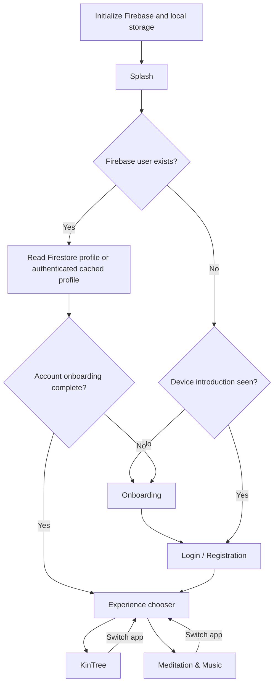

# IIS Mobile Application

A standalone Flutter assignment implementing two Figma experiences: **KinTree** and **Meditation & Music**. Shared onboarding, Firebase Authentication and account setup lead to a chooser; users can return to it without signing out.

## Submission files

- Source: [https://github.com/nashirdrabi/iis-mobile-app-assignment](https://github.com/nashirdrabi/iis-mobile-app-assignment).
- Android APK: `build/app/outputs/flutter-apk/app-release.apk` after the build below.
- Figma comparisons: [design_review/index.html](design_review/index.html), with nine side-by-side screen comparisons.
- Auth/splash previews: [auth flow](design_review/auth_flow.png) and `design_review/current/auth_*.png`.
- Firebase verification: [backend results](docs/verification/firebase_backend.json) and [published rules](docs/verification/firestore-rules-published.png).
- Requirement audit: [docs/REQUIREMENTS.md](docs/REQUIREMENTS.md).

## SDK and setup

Pinned to **Flutter 3.47.9 stable / Dart 3.13.7** in `.fvmrc`. Java 17 and an Android SDK are required. The assignment's ignored `.tooling/flutter` SDK is isolated from the machine's shared SDK and other projects. It is not committed.

With Flutter 3.47.9 on your PATH:

```sh
flutter pub get
flutter run
```

On the development machine, the same commands can use `.tooling/flutter/bin/flutter`. With FVM installed, `fvm install` and `fvm flutter run` use the pinned release. See the [official Flutter setup guide](https://docs.flutter.dev/install).

## Firebase setup

The supplied Android client configuration is installed at `android/app/google-services.json`:

- Firebase project: `iis-mobile-application-12e04`.
- Android application ID: `com.indosakura.iis_mobile_application`.
- Firebase initializes on **every launch**. There is no local authentication adapter, optional Firebase build flag, or fake sign-in in the application.

For this project or a fresh Firebase project:

1. Register the Android application ID and download `google-services.json` into `android/app/`.
2. Enable **Authentication → Sign-in method → Email/Password**.
3. Create the default Firestore database.
4. Publish the checked-in `firestore.rules`. These allow only the authenticated owner to access `users/{uid}` and validate the required profile field types. Other collections are denied by default.
5. If using the CLI, sign in with an account that owns the project, then run:

```sh
firebase deploy --only firestore:rules --project iis-mobile-application-12e04
```

The rules were also published and checked against the supplied assignment project. A live backend check verified registration, sign-in, profile creation/read, onboarding updates and rejection of anonymous profile reads. Its temporary account and document were deleted after verification. No passwords or tokens are stored in the verification report.

Only Android Firebase configuration was supplied. iOS requires a matching `GoogleService-Info.plist` and platform registration; iOS/web/desktop Firebase runs have not been verified.

## Account and onboarding flow



Assumptions:

- A single account accesses both experiences. The introductory screen explains both products and uses the meditation palette, as requested.
- Anonymous introduction completion is stored locally. Registration copies that completion status into the new Firestore profile. An existing account whose remote status is incomplete resumes onboarding even when the device has seen the introduction.
- Name, email and UID form the basic account profile. Name is collected at registration and can be edited from KinTree Profile.
- Figma's family members, archive records, meditation statistics and content are sample product data. This assignment persists account/onboarding data in Firebase; it does not require a backend for every illustrated feature.

### Firestore model

`users/{FirebaseAuth.uid}`:

| Field | Type | Purpose |
|---|---|---|
| `uid` | string | Firebase Auth user ID; must equal the document ID |
| `displayName` | string | Name captured at registration / profile edit |
| `email` | string | Firebase account email |
| `onboardingComplete` | boolean | Account introduction completion |
| `createdAt` | server timestamp | Initial profile creation |
| `updatedAt` | server timestamp | Most recent profile write |

## Architecture and packages

Dependency direction is presentation → domain contracts ← data adapters. UI widgets do not call Firebase or SharedPreferences directly. Riverpod composes the dependencies and manages account operations, page selections, filters, local conversation state, playlists and playback selection.

```text
lib/
  main.dart                         Firebase/bootstrap loading and retry
  app.dart                          Theme, named routes, splash, entry gate, chooser
  core/
    routing/                        Route names
    state/                          Riverpod ephemeral selection/list state
    theme/                          Shared colors and geometry tokens
    widgets/                        Brand, outline icons, switch control
  features/
    auth/
      domain/                       AuthRepository, UserProfile, UserProfileStore, ProfileCache, AuthFailure
      data/                         Firebase Auth, FirestoreProfileStore + preferences cache adapters
      presentation/                 Auth controller, onboarding, login, registration
    kintree/presentation/           Four Figma screens and chat detail
    meditation/
      domain/                       PlaylistRepository contract
      data/                         User-scoped SharedPreferences playlist adapter
      presentation/                 Five Figma screens, playlist/playback Riverpod state
```

Root feature files re-export their presentation entry points for stable imports. Small presentational components sit alongside the screens they compose. Common palette, geometry, icon and brand definitions are shared; Figma-specific measurements stay in the relevant component.

| Package | Why it is used |
|---|---|
| `flutter_riverpod` | Sole application state-management library; dependency injection and asynchronous operation states |
| `firebase_core` | Initialize the platform Firebase app |
| `firebase_auth` | Email/password registration, sign-in, persisted Firebase session and sign-out |
| `cloud_firestore` | Account profile and onboarding persistence |
| `shared_preferences` | Introduction flag, UID-scoped profile cache and UID-scoped local playlists |
| `flutter_svg` | Consistent scalable outline icons |
| `cupertino_icons` | Flutter platform icon support |
| `flutter_test`, `flutter_lints` | Widget/unit verification and Dart lint rules |
| `fake_cloud_firestore`, `firebase_auth_mocks`, `mock_exceptions` | Test-only Firebase adapter and security-rule checks; never used by the running app |

Text controllers and widget lifecycle classes own only input/lifecycle resources. Application and selection state uses Riverpod; there are no `setState` calls.

## Completed screens and states

- KinTree: Home, Family Tree, Family Chat Inbox, User Profile; extra local Chat Detail.
- Meditation: Home, My Albums, Playlists, My Profile, Settings & Practice; extra player sheet.
- Shared: themed native/Flutter splash, initialization retry, onboarding, login, registration, account recovery page, experience chooser.
- Loading: Firebase/bootstrap, account restoration, authentication and onboarding submission.
- Empty: the Figma Albums library, filters and prototype collection placeholders.
- Error: form validation, readable Firebase errors, startup/profile retry, profile and playlist save failure messages.
- Success: authenticated chooser, saved onboarding, profile update feedback and local playlist confirmation.
- Navigation: named main/auth/settings routes, nested detail navigation, working back stack and switching between experiences.

## Local storage and offline behavior

- Firebase Auth owns session persistence. Passwords and session tokens are never placed in SharedPreferences.
- Device introduction: `assignment.onboarding.complete`.
- Profile cache: `assignment.profile.{uid}`, containing the basic profile and onboarding status. It is consulted only when Firebase already has that authenticated UID and the Firestore read fails due to a network error. Permission failures do not fall back to the cache. Signing out clears the cached profile.
- Playlists: `assignment.music.{uid}.playlists`. One account cannot read another account's local playlists through the app.
- Firestore's Android SDK supplies its standard disk cache and queued writes. Explicit timeouts make stalled reads/writes retryable. A first-time offline user receives a connection error and Retry action.
- Public family/media sample content and bundled images remain available offline. New authentication requires a network connection. Family edits and chat samples are in memory; only custom playlist names persist locally.

## Design and responsiveness

KinTree uses `#FBF9F4`, Georgia serif headings and Roboto interface copy. Meditation uses Inter with `#4F46E5` and `#7C3AED`; the inspected Settings styles use Plus Jakarta Sans and Sora, and the Albums empty-state title uses Playfair Display. Fonts are bundled.

The layout uses a 448px content maximum, scrollable screens, flexible text and a horizontally pannable family tree. The supplied rounded square meditation avatar is used for Profile; Settings uses the Figma circular treatment. Settings group shadows are outside their rounded clipping bounds. Native launch surfaces use the same lavender palette in light and dark system modes.

`design_review/index.html` places normalized Figma references next to rendered Flutter screens. References exclude outer export margins and iOS status bars and are normalized to 390 logical pixels. These are review evidence, not a claim of mathematical pixel identity; system insets, text scaling and font rasterization can differ by device.

## Verification and builds

```sh
flutter analyze
flutter test --coverage
python3 tool/generate_design_comparisons.py  # requires Pillow
flutter build apk --release
```

The automated suite has 25 passing tests. It covers profile/cache serialization and user isolation, Firebase repository operations, account-specific onboarding, failed operations preserving the session, login/registration validation and navigation, switching experiences and offline fallback and all Figma layouts at 390px/320px. Auth/splash renders are captured too. Security-rule ownership and type validation are checked against the live Firebase backend using `python3 tool/verify_firebase_backend.py --run-live`. This explicitly creates and deletes disposable test accounts/documents. See `docs/verification/` for the latest verification summary. The GitHub Actions workflow repeats analyze, tests and release APK generation on the pinned SDK.

The evaluation APK uses the project's debug signing identity in release mode; a production Play Store upload needs a separately managed release keystore. Do not commit keystores or service-account credentials.

## Known limitations

- Sample family content, chat messages, AI archive answers, meditation playback, saved downloads, stats and several secondary settings are visual prototypes. There is no audio streaming engine, real-time family backend, AI service, biometrics or billing integration.
- KinTree profile name is editable Firebase account data. Meditation's named demo profile/statistics preserve the supplied Figma example.
- The full nine-screen Figma comparison is supplied, but no zero-pixel-difference claim is made.
- APK generation and backend API checks are verified separately from device end-to-end interaction. iOS/web/desktop and store deployment are outside the supplied Android configuration.
- Repository: [https://github.com/nashirdrabi/iis-mobile-app-assignment](https://github.com/nashirdrabi/iis-mobile-app-assignment). Give the reviewer access if the repository is private.
